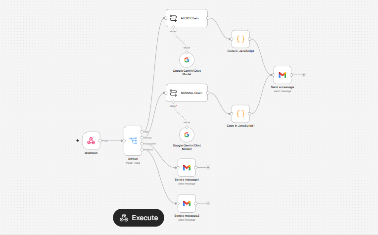
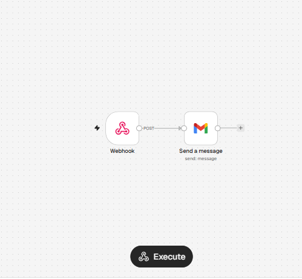
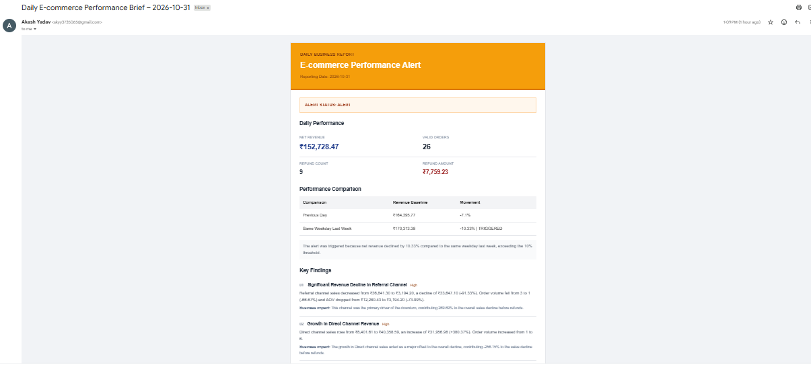
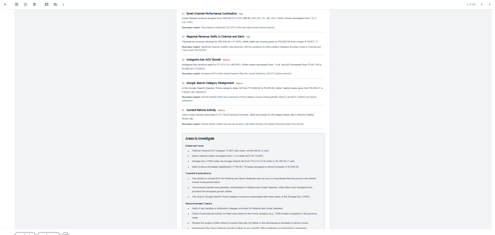
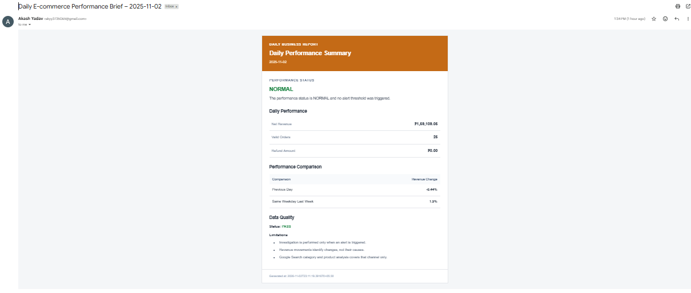
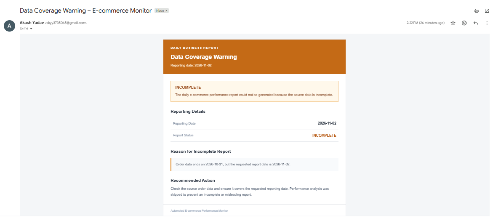
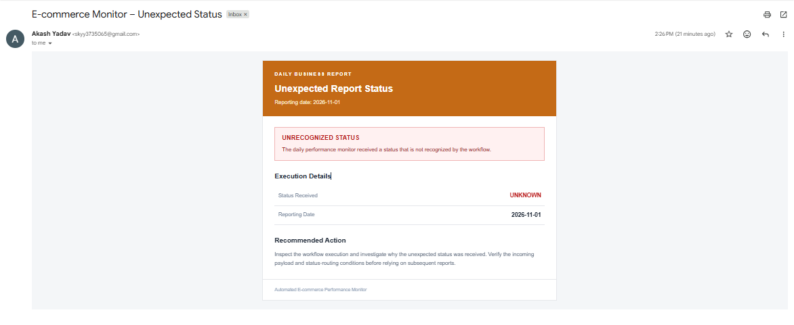
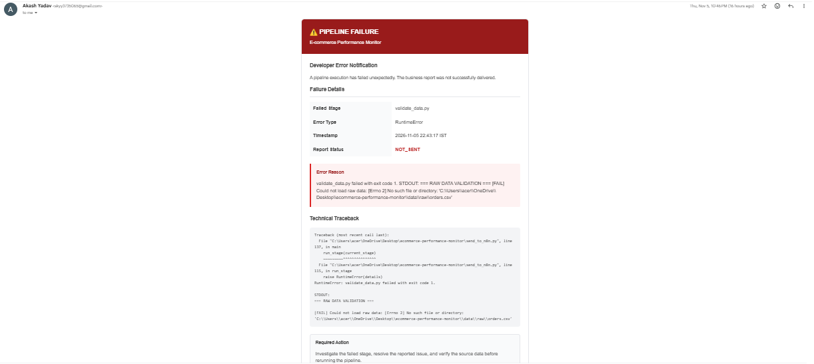

# AI-Powered E-commerce Performance Monitor

An automated e-commerce analytics and monitoring system that tracks daily business performance, detects significant revenue changes, investigates potential drivers using AI, and delivers structured email reports.

Built using **Python, SQL, DuckDB, Parquet, n8n, Gemini, and Gmail**.

## Project Overview

E-commerce businesses need to monitor revenue, orders, refunds, and other performance indicators regularly. Manually reviewing these metrics every day can be time-consuming and may delay the identification of important performance changes.

This project automates that process through a data pipeline and an AI-powered reporting workflow.

The system:

- Generates and processes synthetic e-commerce data.
- Validates source data before analysis.
- Performs incremental data ingestion.
- Uses DuckDB and SQL to calculate daily business KPIs.
- Compares current performance against previous-day and same-weekday baselines.
- Detects significant performance movements.
- Uses Gemini to generate evidence-based business insights when an alert is triggered.
- Sends automated email reports through n8n and Gmail.
- Sends separate developer notifications when the Python pipeline fails.

## System Architecture

The following diagram illustrates the end-to-end data pipeline, analytics processing, AI investigation, and automated reporting architecture.

```text
Synthetic E-commerce Data
          |
          v
    Python Pipeline
          |
          v
   Data Validation
          |
          v
 Incremental Ingestion
          |
          v
   Parquet + DuckDB
          |
          v
     SQL Analysis
          |
          v
   Reporting Payload
          |
          v
      n8n Webhook
          |
          v
    Status Routing
          |
     +----+----+----------------+
     |         |                |
    ALERT    NORMAL         INCOMPLETE
     |         |                |
   Gemini    Gemini           Warning
     |         |                |
     +---------+----------------+
               |
               v
             Gmail

Separate Error Notification:
Python Pipeline Failure
          |
          v
   Developer Webhook
          |
          v
         Gmail
```
## Workflow Architecture

### Main Reporting Workflow

The main n8n workflow receives the daily analytics payload, evaluates the reporting status, generates the appropriate email content, and sends the report through Gmail. AI-powered business investigation is triggered for revenue alerts.



### Developer Error Workflow

A separate webhook-triggered workflow receives Python pipeline failure details and sends a developer notification with the error message and traceback.




## Technology Stack

| Technology | Purpose                                                             |
| ---------- | ------------------------------------------------------------------- |
| Python     | Data generation, cleaning, validation, ingestion, and orchestration |
| Pandas     | Data processing and transformation                                  |
| DuckDB     | Analytical database and SQL execution                               |
| SQL        | KPI calculations and performance comparisons                        |
| Parquet    | Processed data storage                                              |
| n8n Cloud  | Workflow orchestration, branching, and automation                   |
| Gemini     | AI-generated business performance summaries and investigations      |
| Gmail      | Automated report and error notifications                            |

## Dataset

The project uses synthetic e-commerce data representing approximately 12 months of business activity.

The dataset contains five interconnected tables:

| Dataset     | Description                                                        |
| ----------- | ------------------------------------------------------------------ |
| Orders      | Order dates, customers, order status, discounts, and order details |
| Order Items | Individual products and quantities within orders                   |
| Products    | Product attributes and categories                                  |
| Refunds     | Refund records and refund issue dates                              |
| Sessions    | Website sessions and acquisition information                       |

The generated dataset contains approximately:

- 10,000 orders
- 24,000+ order-item records
- 25 products
- Multiple marketing channels, regions, and product categories

All data is synthetic and is used for portfolio demonstration and testing.

## Business Logic and KPI Definitions

### Revenue Calculation

Net revenue is calculated after applicable discounts and refunds.

- Product-level and order-level discounts are deducted.
- Taxes and shipping charges are excluded.
- Refunds are deducted on the date the refund is issued.
- Partial refunds are included.
- Cancelled orders are excluded from valid placed orders.
- Processing, shipped, and delivered orders are included.

### Daily Performance Monitoring

The system monitors:

- nue
- Valid Net ReveOrders
- Refund Amount
- Refund Count
- Average Order Value (AOV)

Revenue is compared against:

1. Previous day
2. Same weekday in the previous week

### Alert Threshold

A performance alert is triggered when absolute net revenue movement reaches or exceeds 10% against either available comparison baseline.

The system distinguishes between increases and decreases rather than assuming every alert represents poor performance.

If a comparison baseline is unavailable, the corresponding percentage change is not treated as a valid comparison.

## AI-Powered Business Investigation

When an ALERT is triggered, Gemini receives structured analytical data and generates a business performance brief.

The investigation can cover:

- Marketing channel performance
- Regional revenue movements
- Product and category performance
- Order volume and AOV changes
- Refund activity
- Positive and negative contributors to revenue movement

The AI-generated brief follows an evidence-based approach:

- Uses only supplied analytical results.
- Separates observed facts from possible explanations.
- Avoids unsupported causal claims.
- Identifies recommended areas for further investigation.
- Prioritizes findings based on business impact.

AI is used to interpret analytical results, not to replace the underlying KPI calculations.

## Automated Email Reporting

The n8n workflow receives the reporting payload and routes it according to the overall report status.

| Status            | Workflow behaviour                                                    |
| ----------------- | --------------------------------------------------------------------- |
| ALERT             | Generates a detailed Gemini investigation and sends an alert email    |
| NORMAL            | Generates a concise Gemini KPI summary and sends a normal report      |
| INCOMPLETE        | Sends a data coverage warning without generating performance analysis |
| Unexpected Status | Sends a notification for an unrecognized report status                |
| Developer Error   | A separate workflow sends Python pipeline failure notifications       |

The email templates use consistent HTML formatting, with different visual indicators for each report status.

## Email Report Examples

The system generates different email reports depending on performance status and data quality.

### 1. ALERT Report

Triggered when net revenue changes by 10% or more compared with the previous day or the same weekday last week.





### 2. NORMAL Report

Sent when revenue performance remains within the configured alert threshold.



### 3. INCOMPLETE Report

Sent when source data is incomplete or does not cover the required reporting period.



### 4. Unexpected Status Notification

Sent when the reporting workflow encounters an unexpected status that cannot be handled by the standard reporting branches.



### 5. Developer Error Notification

A separate error-handling workflow sends developer notifications when the Python pipeline fails. The notification includes the error details and traceback to support debugging.



## Data Quality and Error Handling

Data quality checks are performed before analytical reporting.

The system is designed to identify issues such as:

- Missing or invalid required fields.
- Missing reporting dates.
- Duplicate records.
- Conflicting duplicate identifiers.
- Invalid transaction values.
- Excessive refunds.
- Incomplete source-data coverage.

### Error Handling Strategy

- Critical data-quality errors prevent unreliable reporting.
- Incomplete source coverage produces an INCOMPLETE report.
- Non-critical data-quality limitations are communicated in the report.
- Transient failures can be retried.
- Python pipeline failures trigger a separate developer notification containing error details and traceback information.

## Automation and Scheduling

The Python pipeline is executed through Windows Task Scheduler.

The pipeline prepares and validates the analytical data, builds the reporting payload, and sends it to the n8n webhook.

n8n handles report generation, status-based routing, and email delivery.

The reporting workflow uses the Asia/Kolkata timezone and INR as its reporting currency.

## Project Structure

```text
ecommerce-performance-monitor/
│
├── data/
│   ├── raw/
│   └── processed/
│
├── sql/
│
├── logs/
│
├── reports/
│
├── generate_data.py
├── prepare_data.py
├── audit_data.py
├── validate_data.py
├── incremental_ingestion.py
├── setup_duckdb.py
├── verify_duckdb.py
├── run_sql.py
├── check_revenue.py
├── build_payload.py
├── send_to_n8n.py
├── inspect_refund_errors.py
├── validate_dates.py
│
├── ai_business_brief_prompt.txt
├── requirements.txt
├── .env.example
├── .gitignore
├── ecommerce.duckdb
└── README.md
```

Generated datasets, local database files, logs, and environment secrets are not intended to be committed to the public repository.

## Running the Project

### Current Setup Status

The pipeline has been tested using the existing locally generated and processed datasets.

A complete fresh-clone setup has not yet been independently validated. The processed Parquet files and local DuckDB database are not included in the repository.

### Prerequisites

- Python 3.13+
- Required Python packages from `requirements.txt`
- n8n Cloud account
- Gemini API access
- Gmail integration configured in n8n

### Local Environment Setup

1. Clone the repository.
2. Create and activate a Python virtual environment.
3. Install dependencies using `requirements.txt`.
4. Configure environment variables using `.env.example`.
5. Ensure the required processed Parquet files are available in `data/processed/`.
6. Initialize the DuckDB database using `setup_duckdb.py`.
7. Configure the required n8n workflows and webhook endpoints.
8. Execute the reporting pipeline using `send_to_n8n.py`.

**Note:** Steps involving data generation, preparation, and fresh-environment initialization are still subject to independent validation. Do not assume that cloning the repository alone provides the processed datasets required to run the pipeline.


## Testing and Validation

The project includes controlled scenarios to verify reporting and error-handling behaviour.

| Scenario                                 | Expected behaviour                    |
| ---------------------------------------- | ------------------------------------- |
| Normal performance                       | NORMAL report                         |
| Revenue movement reaches alert threshold | ALERT report with AI investigation    |
| Incomplete source-date coverage          | INCOMPLETE warning                    |
| Unexpected report status                 | Unexpected-status notification        |
| Python pipeline failure                  | Separate developer error notification |
| Critical data-quality error              | Reporting blocked                     |
| Excessive refund                         | Critical validation failure           |
| Email delivery failure                   | Failure handling and notification     |

The email workflows have been tested with representative ALERT, NORMAL, INCOMPLETE, and unexpected-status scenarios. The separate developer notification workflow has also been tested using a controlled Python pipeline failure.

## Key Learning Outcomes

Through this project, I worked on:

- Building an end-to-end analytical data pipeline.
- Data cleaning, validation, and incremental ingestion.
- Analytical SQL and KPI development using DuckDB.
- Revenue and business metric interpretation.
- Designing threshold-based performance monitoring.
- Integrating Python with n8n webhooks.
- Using AI to generate evidence-based business summaries.
- Automating email reporting and failure notifications.
- Designing data-quality checks and handling pipeline failures.

## Future Improvements

Potential extensions include:

- Power BI dashboard for interactive performance exploration.
- Additional customer and product-level analytical investigations.
- Historical alert tracking and trend analysis.
- Improved monitoring and observability of workflow execution.
- Integration with live e-commerce data sources.

---

**Project Category:** Data Analytics | Business Intelligence | AI Automation

**Author:** Akash Yadav

**Tools:** Python | SQL | DuckDB | Pandas | Parquet | n8n | Gemini | Gmail
